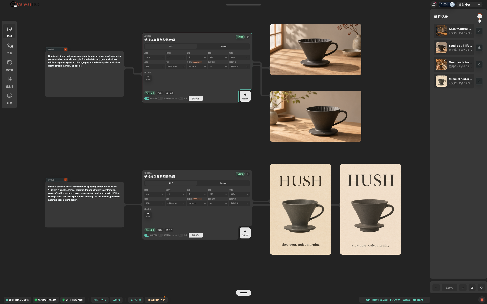

<p align="center">
  <b>English</b> · <a href="README.zh-CN.md">简体中文</a>
</p>

<p align="center">
  
</p>

<h1 align="center">CanvasHub: One Canvas. Every Image Model.</h1>

<h3 align="center">A node-based image workbench where GPT, Gemini, local MLX models and ComfyUI workflows are all just nodes on one canvas.</h3>

<p align="center"><b>Wire prompts, models and images together. Originals are archived by date and can go straight to Telegram.</b></p>

<p align="center">
  <a href="https://github.com/DreamLoveBetty/CanvasHub/releases"></a>
  <a href="LICENSE"></a>
  
  <a href="#docker"></a>
  <a href="https://github.com/DreamLoveBetty/CanvasHub/releases"></a>
  
  <a href="https://github.com/DreamLoveBetty/CanvasHub"></a>
</p>

<p align="center">
  
</p>

<p align="center">
  <a href="#features">Features</a> · <a href="#deployment">Deployment</a> · <a href="#models-and-components">Models</a> · <a href="#configuration">Configuration</a> · <a href="#public-mode-and-safety">Safety</a> · <a href="#license">License</a>
</p>

---

CanvasHub is a self-hosted, node-based image workbench. One Python HTTP server
serves the desktop canvas, the Telegram Mini App and the JSON APIs behind them.
Results stay on your own machine, archived by date together with their prompts.

- GPT Image (Image2) generation needs one of: a local Codex login, an imported
  Codex OAuth, or web RT/AT credentials imported through the account pool.
- Gemini / nano banana generation needs a third-party API.
- The Telegram Mini App needs a public IP, a reverse proxy or a tunnel.

## Features

| Capability | What it does |
|---|---|
| Node canvas | Wire text, model, image, video and audio nodes into workflows on an infinite canvas; 24 node types in the node menu |
| Many models | Switch a model node between GPT and Google (Gemini); online Cyimg nodes plus local Krea 2, Qwen 2.1 and MOSS nodes |
| Fallback | When the local Codex route fails, the task continues on the ChatGPT account pool; progress shows stages (prepare → generating → receive and save) |
| Keep editing | Connect a result straight into the next model node as a reference; built-in image editor (brush, mask, eraser, text and arrow notes) |
| Local models | MLX generation on Apple Silicon: Krea 2 (with region control and LoRA), Qwen-Image 2.1 (multi-reference edit, Turbo), MOSS-Image (text-to-image, layout and storyboard grids) |
| ComfyUI | Run workflows on your own ComfyUI instance with image / video / audio inputs and outputs |
| Video and audio | Video nodes, video-control preprocessing (Depth / Pose / Canny), Topaz video enhancement; local music generation and transcription with mlx-Yue |
| Enhance and upscale | Local 4× upscaling (4x-UltraSharp / 4x-AnimeSharp); optional Topaz Gigapixel using your own licensed install |
| Pose reference | Pose a SOMA 3D mannequin; recognise poses from photos / video with GEM-X |
| Archive and library | Originals are saved by date in the archive directory with prompt sidecar files; browse, filter and favourite them in the asset library |
| Telegram | Results are sent with `sendDocument` as original files, not through the compressed photo channel; submit and review from the Mini App on your phone |
| Prompt tools | Prompt polishing, style presets, a prompt library and optional sync from public prompt repositories |

Node menu groups: image 8 · video 3 · audio 6 · enhance/upscale 3 · general 4.

## Deployment

| Option | Best for | Local MLX models | Notes |
|---|---|---|---|
| [Desktop app](#desktop-app) | Personal use on a Mac | Yes | Install the DMG; data lives in your user directory and survives upgrades |
| [From source](#from-source) | Development, Windows / Linux, customisation | Apple Silicon only | One Python process, listens on `127.0.0.1` by default |
| [Docker](#docker) | Always-on server / NAS, Telegram Mini App | No | Main server + account-pool sidecar, data in a volume |

### Desktop app

Download the macOS (Apple Silicon) build from
[GitHub Releases](https://github.com/DreamLoveBetty/CanvasHub/releases). Settings,
account information, image archives, caches and optional components are stored
in the current user's application-data directory and remain after an upgrade or
reinstall.

The upscale component is not in the initial installer. The first time an upscale
node runs, the app downloads, verifies and installs it in the background and
shows progress; later runs reuse it. The download needs access to GitHub; if it
is interrupted, run the node again to resume. Generation, editing and the gallery
work without it.

Builds without a Developer ID signature are meant for testing: right-click the
app and choose Open, or choose Open Anyway in System Settings → Privacy &
Security. If it is still quarantined:

```bash
xattr -dr com.apple.quarantine /Applications/CanvasHub.app
open /Applications/CanvasHub.app
```

Do not disable Gatekeeper globally. Update unsigned builds by downloading the new DMG.

### From source

```bash
git clone https://github.com/DreamLoveBetty/CanvasHub.git
cd CanvasHub
python3 -m venv .venv
. .venv/bin/activate
python3 -m pip install -r requirements.txt
cp settings.example.json settings.json
python3 server.py
```

Then open <http://127.0.0.1:18463/desktop.html>.

- **Windows**: double-click `start-windows.bat` in the project root (it creates
  `.venv`, installs dependencies and opens the page when needed); double-click
  `stop-windows.bat` to stop.
- **macOS / Linux**: run `./start.sh`.
- When exposing the app through a tunnel or reverse proxy, set
  `MINIAPP_PUBLIC_URL` and `start.sh` prints the URL for BotFather:

  ```bash
  MINIAPP_PUBLIC_URL=https://your-domain.example ./start.sh
  ```

Running from source does not need Node.js. Frontend builds, checks and desktop
packaging are described in [frontend/README.md](frontend/README.md).

### Docker

```bash
cd docker
cp .env.docker.sample .env   # change MINIAPP_ACCESS_PASSWORD and configure at least one image source
docker compose up -d
```

- `server` (port `18463`) is the main app; `sidecar` (port `18080`) is the
  ChatGPT account-pool service. Both share the `canvashub_data` volume, and
  `settings.json` is persisted inside it.
- Configure at least one image source in `.env`: Codex OAuth, a third-party
  GPT-compatible API, Google Gemini or a nano banana-compatible API. Point
  `COMFY_BASE_URL` at your ComfyUI instance.
- The sample password `docker` is a placeholder. Change it and put HTTPS in
  front before exposing the server.
- Docker is a separate deployment model from the desktop app. The MLX local
  models need Apple Silicon and do not run in the container.

## Models and components

Online models only need configuration in the Settings Center. Local models and
components are **optional**: nothing is downloaded at server start; install them
explicitly (a command or Settings Center → Model Tools). Weights are not
distributed with this repository; follow each upstream licence.

### Online models / services

| Node / route | How to connect |
|---|---|
| GPT Image (Codex) | Local Codex login, or import Codex OAuth in the Settings Center |
| ChatGPT account pool | Settings Center → Account pool; provided by `sidecar` in Docker |
| Google Gemini | API key (Settings Center → Third-party) |
| nano banana / GPT-compatible APIs | Third-party API base URL + key |
| Cyimg | Settings Center → Third-party → Cyimg API |
| ComfyUI | `COMFY_BASE_URL` or the Settings Center, pointing at your own ComfyUI |

### Local models (Apple Silicon · MLX)

| Node | Upstream model / code | Install | Notes |
|---|---|---|---|
| Krea 2 · MLX / Krea 2 region control | [krea/Krea-2-Turbo](https://huggingface.co/krea/Krea-2-Turbo) · [avlp12/krea2_alis_mlx](https://github.com/avlp12/krea2_alis_mlx) | `python -m backend.krea2.install --models 8bit` | 8-bit needs about 23 GiB for the transformer alone; see [backend/krea2](backend/krea2/README.md) |
| Qwen 2.1 · MLX | [vanch007/Qwen-Image-2.1-Heretic-mlx-8bit](https://huggingface.co/vanch007/Qwen-Image-2.1-Heretic-mlx-8bit) · Turbo: [Viggle/Qwen-Image-2.1-viggle-turbo](https://huggingface.co/Viggle/Qwen-Image-2.1-viggle-turbo) · runtime: [mflux](https://github.com/mflux-community/mflux) | `python -m backend.qwen21.bundle_import --source <download dir>` | Text-to-image and one/two-reference edits; see [backend/qwen21](backend/qwen21/README.md) |
| MOSS · local / Layout | [OpenMOSS-Team/MOSS-Image-SFT](https://huggingface.co/OpenMOSS-Team/MOSS-Image-SFT) · [mflux-community/moss-image-sft-mflux-bf16](https://huggingface.co/mflux-community/moss-image-sft-mflux-bf16) · Turbo: [VisualInference/MOSS-Image-SFT-Turbo-MLX](https://huggingface.co/VisualInference/MOSS-Image-SFT-Turbo-MLX) | `python -m backend.moss.environment prepare --source <weights dir>` | Text-to-image, free layout, storyboard grids; see [backend/moss](backend/moss/README.md) |
| Music (mlx-Yue) | [vanch007/mlx-Yue2-3B](https://huggingface.co/vanch007/mlx-Yue2-3B) · [m-a-p/YuE2-Vae](https://huggingface.co/m-a-p/YuE2-Vae) · [m-a-p/SheetSage2](https://huggingface.co/m-a-p/SheetSage2) · [m-a-p/MERT-v2-FullSong](https://huggingface.co/m-a-p/MERT-v2-FullSong) · code: [vanch007/mlx-Yue](https://github.com/vanch007/mlx-Yue) | `python -m backend.audio.install` | Generation, transcription, ABC-reference generation; see [backend/audio](backend/audio/README.md) |

### Other optional components

| Component | Upstream | Install | Notes |
|---|---|---|---|
| Local upscale | [4x-UltraSharp](https://huggingface.co/lokCX/4x-Ultrasharp) · [4x-AnimeSharp](https://huggingface.co/utnah/esrgan) | Desktop app installs it on first use; from source, put the weights in `models/upscale/` | See [models/upscale](models/upscale/README.md) |
| Pose mannequin (SOMA) | [nvidia/soma-x](https://huggingface.co/nvidia/soma-x) (Apache-2.0) | `python -m backend.pose_scene.install` | About 59 MB; generates neutral / female / male mannequins; see [backend/pose_scene](backend/pose_scene/README.md) |
| Pose recognition (GEM-X) | [NVlabs/GEM-X](https://github.com/NVlabs/GEM-X) · optional [CoMotion](https://github.com/apple-aiml-research/ml-comotion), [SAM 3D Body](https://github.com/facebookresearch/sam-3d-body) | `python -m backend.pose_capture.install` | About 4.4 GB; see [backend/pose_capture](backend/pose_capture/README.md) |
| Video-control preprocessing | ReShot pipeline (Depth / Pose / Canny) | `python -m backend.video_control.install --models-from <dir>` | See [backend/video_control](backend/video_control/README.md) |
| Topaz Gigapixel / Video | Requires your own installed and licensed Topaz app | `python -m backend.topaz.provision` | No Topaz files are distributed with the project; see [backend/topaz](backend/topaz/README.md) |

Full third-party code and asset notices: [THIRD_PARTY_NOTICES.md](THIRD_PARTY_NOTICES.md).

### Optional: remote prompt sources at runtime

The gallery workspace can sync prompt / example-image records from public
repositories at runtime; data is written to local runtime paths such as
`data/source_images/`. Thanks to these authors for collecting and open-sourcing them:

| Source | Upstream repository |
|---|---|
| GPT Image 2 | [EvoLinkAI/awesome-gpt-image-2-API-and-Prompts](https://github.com/EvoLinkAI/awesome-gpt-image-2-API-and-Prompts) |
| Awesome GPT Image | [ZeroLu/awesome-gpt-image](https://github.com/ZeroLu/awesome-gpt-image) |
| GPT-4o Image | [ImgEdify/Awesome-GPT4o-Image-Prompts](https://github.com/ImgEdify/Awesome-GPT4o-Image-Prompts) |
| YouMind GPT Image 2 | [YouMind-OpenLab/awesome-gpt-image-2](https://github.com/YouMind-OpenLab/awesome-gpt-image-2) |
| YouMind Nano Banana Pro | [YouMind-OpenLab/awesome-nano-banana-pro-prompts](https://github.com/YouMind-OpenLab/awesome-nano-banana-pro-prompts) |
| DavidWu GPT Image2 Prompts | [davidwuw0811-boop/awesome-gpt-image2-prompts](https://github.com/davidwuw0811-boop/awesome-gpt-image2-prompts) |

## Configuration

Most runtime settings can be edited in the desktop Settings Center:

- **System**: bind address, port, public mode, access password.
- **Telegram**: bot token, chat id, allowed user ids, Telegram proxy.
- **Provider**: local Codex provider, managed Codex OAuth, transport mode, timeout.
- **Third-party**: nano banana / Gemini / Cyimg / compatible image APIs.
- **Account pool**: account connections and authorised-account management.
- **Polish**: prompt-skill provider / model.
- **Model Tools**: install status, conversion and LoRA for local models.
- **Paths**: archive directory, source image directory, tasks database.

Default storage paths are project-local (the desktop app uses the user data directory):

```text
data/archive
data/source_images
tasks.db
```

Change them in Settings Center → Paths; relative paths resolve from the
repository root. `settings.json` is local configuration and may contain secrets —
do not commit it.

## Public mode and safety

Defaults:

- The server binds to `127.0.0.1`.
- Public mode is opt-in in Settings Center → System and requires a non-empty
  Mini App access password.
- Runtime data and local secrets are ignored by Git.
- The built-in password gate is lightweight access control, not enterprise
  multi-user RBAC.

To enable public mode:

1. Open `desktop.html` and go to Settings Center → System.
2. Enable Public Mode and set an access password.
3. Save and restart the Python server.

Public mode only changes the bind address. For an internet-facing deployment,
use HTTPS, a reverse proxy, firewall rules and Telegram domain settings suited
to your environment.

## Development

```bash
PYTHONPATH="$PWD" python3 tests/run_regressions.py   # Python regressions
node tests/run_node_regressions.mjs                  # frontend Node regressions
(cd frontend && npm run -s check)                    # build fingerprint + asset cache keys
```

- Module boundaries and working rules: [AGENTS.md](AGENTS.md), [backend/README.md](backend/README.md), [frontend/README.md](frontend/README.md)
- [LoRA strength fix and Krea2 edit-stack investigation · 2026-10-26](backend/LORA_STRENGTH_HANDOFF_2026-10-26.md)

## License

Project-owned source code is licensed under the [MIT License](LICENSE). Bundled
third-party code and assets remain under their own licenses; see
[THIRD_PARTY_NOTICES.md](THIRD_PARTY_NOTICES.md). Local model weights are not
distributed with the project and follow their upstream licenses.
