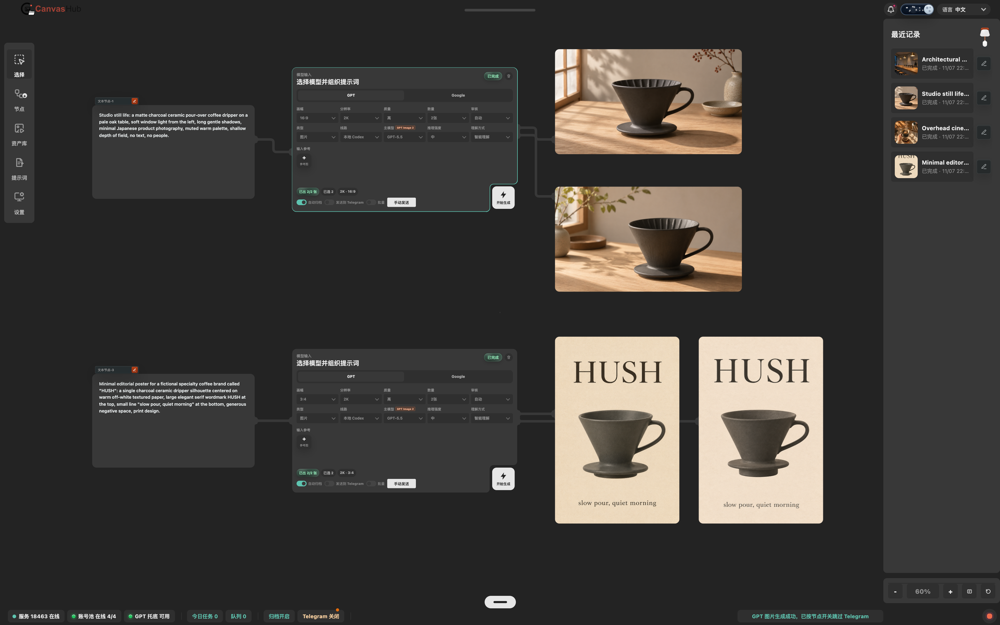

<p align="center">
  <a href="README.md">English</a> · <b>简体中文</b>
</p>

<p align="center">
  
</p>

<h1 align="center">CanvasHub：一张画布，接上你所有的生图模型</h1>

<h3 align="center">节点式图像工作台：GPT、Gemini、本地 MLX 模型与 ComfyUI 工作流都是画布上的一个节点。</h3>

<p align="center"><b>提示词、模型、图片用线连起来；原图按日期归档，可直发 Telegram。</b></p>

<p align="center">
  <a href="https://github.com/DreamLoveBetty/CanvasHub/releases"></a>
  <a href="LICENSE"></a>
  
  <a href="#docker-部署"></a>
  <a href="https://github.com/DreamLoveBetty/CanvasHub/releases"></a>
  
  <a href="https://github.com/DreamLoveBetty/CanvasHub"></a>
</p>

<p align="center">
  
</p>

<p align="center">
  <a href="#功能">功能</a> · <a href="#部署">部署</a> · <a href="#模型与组件">模型与组件</a> · <a href="#配置">配置</a> · <a href="#公网模式与安全">安全</a> · <a href="#许可">许可</a>
</p>

---

CanvasHub 是一个自托管的节点式图像工作台：一个 Python HTTP 服务同时提供桌面画布、Telegram 小程序和它们使用的 JSON API。生成结果存在你自己的电脑上，按日期归档并附带提示词。

- GPT Image（Image2）生成需要以下任一来源：本地 Codex 登录、导入 Codex OAuth，或通过账号池导入 Web 端 RT/AT。
- Gemini / nano banana 生成需要接入第三方 API。
- Telegram 小程序需要公网 IP、反向代理或隧道穿透。

## 功能

| 能力 | 说明 |
|---|---|
| 节点画布 | 无限画布上用连线把文本、模型、图片、视频、音频节点串成工作流；节点菜单共 24 种节点 |
| 多模型 | 模型节点内切换 GPT / Google（Gemini）；另有绘栾在线模型、Krea 2、Qwen 2.1、MOSS 等本地模型节点 |
| 生成兜底 | 本地 Codex 线路失败时，任务自动转到 ChatGPT 账号池继续生成；进度按「准备 → 生成中 → 接收并保存」阶段显示 |
| 继续编辑 | 生成结果可直接连到下一个模型节点当参考图；内置图片编辑器（画笔、蒙版、擦除、文字与箭头标注） |
| 本地模型 | Apple Silicon 上用 MLX 本地生成：Krea 2（含区域控制与 LoRA）、Qwen-Image 2.1（多参考编辑、Turbo）、MOSS-Image（文生图与版面/分镜） |
| ComfyUI | 接入你自己的 ComfyUI 实例，按工作流运行，支持图片 / 视频 / 音频输入输出 |
| 视频与音频 | 视频节点、视频控制预处理（Depth / Pose / Canny）、Topaz 视频增强；mlx-Yue 本地音乐生成与转写 |
| 增强放大 | 本地高清放大（4x-UltraSharp / 4x-AnimeSharp）；可选接入本机已授权的 Topaz Gigapixel |
| 姿态参考 | SOMA 3D 人偶摆姿，GEM-X 从照片 / 视频识别姿态 |
| 归档与资产库 | 原图按日期存入归档目录并写入提示词旁注文件；资产库浏览、筛选、收藏 |
| Telegram | 结果通过 `sendDocument` 发原文件，不走压缩的图片通道；小程序可在手机上提交与查看 |
| 提示词工具 | 提示词润色、风格预设、提示词库，以及可选的公开提示词仓库同步 |

节点菜单分组：图像 8 · 视频 3 · 音频 6 · 增强放大 3 · 通用 4。

## 部署

| 方式 | 适合 | 本地 MLX 模型 | 说明 |
|---|---|---|---|
| [桌面 App](#桌面-app) | 个人在 Mac 上使用 | 可用 | 下载 DMG 即用，数据存在用户目录，升级不丢 |
| [源码运行](#源码运行) | 开发、Windows / Linux、自行定制 | 仅 Apple Silicon | 一个 Python 进程，默认只监听 `127.0.0.1` |
| [Docker 部署](#docker-部署) | 服务器 / NAS 长期运行、Telegram 小程序 | 不可用 | 主服务 + 账号池 sidecar，数据在 volume 中 |

### 桌面 App

从 [GitHub Releases](https://github.com/DreamLoveBetty/CanvasHub/releases) 下载 macOS（Apple Silicon）安装包。应用设置、账号信息、图片归档、缓存和可选组件保存在当前用户的数据目录中，覆盖安装或升级不会清除。

高清放大组件不在首次安装包内：第一次运行高清放大节点时，应用会在后台自动下载、校验并安装，界面显示进度；之后直接复用。下载需要能访问 GitHub，中断后重新运行节点即可继续。普通生图、编辑和图库不受影响。

未使用 Developer ID 签名的版本适合内测：右键应用选择「打开」，或在「系统设置 → 隐私与安全性」中选择「仍要打开」。如果仍被隔离：

```bash
xattr -dr com.apple.quarantine /Applications/CanvasHub.app
open /Applications/CanvasHub.app
```

不要全局关闭 Gatekeeper。未签名版本请通过重新下载新版 DMG 手动更新。

### 源码运行

```bash
git clone https://github.com/DreamLoveBetty/CanvasHub.git
cd CanvasHub
python3 -m venv .venv
. .venv/bin/activate
python3 -m pip install -r requirements.txt
cp settings.example.json settings.json
python3 server.py
```

然后打开 <http://127.0.0.1:18463/desktop.html>。

- **Windows**：在项目根目录双击 `start-windows.bat` 一键启动（需要时自动创建 `.venv`、安装依赖并打开页面）；双击 `stop-windows.bat` 停止。
- **macOS / Linux**：`./start.sh` 启动本地应用。
- 通过隧道或反向代理暴露时，设置 `MINIAPP_PUBLIC_URL`，`start.sh` 会打印用于 BotFather 配置的地址：

  ```bash
  MINIAPP_PUBLIC_URL=https://your-domain.example ./start.sh
  ```

普通源码启动不需要 Node.js；前端构建、校验与桌面打包见 [前端构建说明](frontend/README.md)。

### Docker 部署

```bash
cd docker
cp .env.docker.sample .env   # 至少修改 MINIAPP_ACCESS_PASSWORD，并配置一个生图来源
docker compose up -d
```

- `server`（端口 `18463`）：主服务；`sidecar`（端口 `18080`）：ChatGPT 账号池服务。两者共用 `canvashub_data` volume，`settings.json` 写在 volume 内持久化。
- 生图来源在 `.env` 中至少配置一个：Codex OAuth、第三方 GPT 兼容接口、Google Gemini 或 nano banana 兼容接口；`COMFY_BASE_URL` 指向你的 ComfyUI 实例。
- 示例密码 `docker` 只是占位值，对外开放前务必修改，并在前面加 HTTPS 反向代理。
- Docker 是独立的部署模式，与桌面 App 的更新方式不同；MLX 本地模型需要 Apple Silicon，不在容器内运行。

## 模型与组件

在线模型通过设置中心配置即可使用。本地模型与组件都是**可选**的：服务启动时不会自动下载，需要显式安装（命令或「设置中心 → 模型工具」）。权重不随仓库分发，使用时请遵守各上游的许可。

### 在线模型 / 服务

| 节点 / 线路 | 接入方式 |
|---|---|
| GPT Image（Codex） | 本地 Codex 登录，或设置中心导入 Codex OAuth |
| ChatGPT 账号池 | 设置中心 → 账号池；Docker 中由 `sidecar` 提供 |
| Google Gemini | 第三方 / 官方 API Key（设置中心 → 第三方） |
| nano banana / GPT 兼容接口 | 第三方 API Base URL + Key |
| 绘栾图像 | 设置中心 → 第三方 → 绘栾 API |
| ComfyUI | `COMFY_BASE_URL` 或设置中心指向你自己的 ComfyUI |

### 本地模型（Apple Silicon · MLX）

| 节点 | 上游模型 / 代码 | 安装 | 说明 |
|---|---|---|---|
| Krea 2 · MLX / Krea 2 区域控制 | [krea/Krea-2-Turbo](https://huggingface.co/krea/Krea-2-Turbo) · [avlp12/krea2_alis_mlx](https://github.com/avlp12/krea2_alis_mlx) | `python -m backend.krea2.install --models 8bit` | 8bit 仅 transformer 约需 23 GiB 内存；详见 [backend/krea2](backend/krea2/README.md) |
| Qwen 2.1 · MLX | [vanch007/Qwen-Image-2.1-Heretic-mlx-8bit](https://huggingface.co/vanch007/Qwen-Image-2.1-Heretic-mlx-8bit) · Turbo：[Viggle/Qwen-Image-2.1-viggle-turbo](https://huggingface.co/Viggle/Qwen-Image-2.1-viggle-turbo) · 运行时：[mflux](https://github.com/mflux-community/mflux) | `python -m backend.qwen21.bundle_import --source <下载目录>` | 文生图与 1–2 张参考图编辑；详见 [backend/qwen21](backend/qwen21/README.md) |
| MOSS · 本地生成 / Layout | [OpenMOSS-Team/MOSS-Image-SFT](https://huggingface.co/OpenMOSS-Team/MOSS-Image-SFT) · [mflux-community/moss-image-sft-mflux-bf16](https://huggingface.co/mflux-community/moss-image-sft-mflux-bf16) · Turbo：[VisualInference/MOSS-Image-SFT-Turbo-MLX](https://huggingface.co/VisualInference/MOSS-Image-SFT-Turbo-MLX) | `python -m backend.moss.environment prepare --source <权重目录>` | 文生图、自由布局、分镜网格；详见 [backend/moss](backend/moss/README.md) |
| 音乐生成（mlx-Yue） | [vanch007/mlx-Yue2-3B](https://huggingface.co/vanch007/mlx-Yue2-3B) · [m-a-p/YuE2-Vae](https://huggingface.co/m-a-p/YuE2-Vae) · [m-a-p/SheetSage2](https://huggingface.co/m-a-p/SheetSage2) · [m-a-p/MERT-v2-FullSong](https://huggingface.co/m-a-p/MERT-v2-FullSong) · 代码：[vanch007/mlx-Yue](https://github.com/vanch007/mlx-Yue) | `python -m backend.audio.install` | 生成、转写、ABC 参考生成；详见 [backend/audio](backend/audio/README.md) |

### 其他可选组件

| 组件 | 上游 | 安装 | 说明 |
|---|---|---|---|
| 本地高清放大 | [4x-UltraSharp](https://huggingface.co/lokCX/4x-Ultrasharp) · [4x-AnimeSharp](https://huggingface.co/utnah/esrgan) | 桌面 App 首次使用自动安装；源码运行把权重放进 `models/upscale/` | 见 [models/upscale](models/upscale/README.md) |
| 姿态人偶（SOMA） | [nvidia/soma-x](https://huggingface.co/nvidia/soma-x)（Apache-2.0） | `python -m backend.pose_scene.install` | 下载约 59 MB，生成中性 / 女性 / 男性人偶；见 [backend/pose_scene](backend/pose_scene/README.md) |
| 姿态识别（GEM-X） | [NVlabs/GEM-X](https://github.com/NVlabs/GEM-X) · 可选 [CoMotion](https://github.com/apple-aiml-research/ml-comotion)、[SAM 3D Body](https://github.com/facebookresearch/sam-3d-body) | `python -m backend.pose_capture.install` | 下载约 4.4 GB；见 [backend/pose_capture](backend/pose_capture/README.md) |
| 视频控制预处理 | ReShot 流程（Depth / Pose / Canny） | `python -m backend.video_control.install --models-from <目录>` | 见 [backend/video_control](backend/video_control/README.md) |
| Topaz Gigapixel / Video | 需要本机已安装并授权的 Topaz 应用 | `python -m backend.topaz.provision` | 不随项目分发任何 Topaz 文件；见 [backend/topaz](backend/topaz/README.md) |

完整的第三方代码与资产说明见 [THIRD_PARTY_NOTICES.md](THIRD_PARTY_NOTICES.md)。

### 可选：运行时远程提示词来源

图库工作区可以在运行时同步公开仓库中的提示词 / 示例图，数据写入 `data/source_images/` 等本地目录。感谢以下作者的收集与开源：

| 来源 | 上游仓库 |
|---|---|
| GPT Image 2 | [EvoLinkAI/awesome-gpt-image-2-API-and-Prompts](https://github.com/EvoLinkAI/awesome-gpt-image-2-API-and-Prompts) |
| Awesome GPT Image | [ZeroLu/awesome-gpt-image](https://github.com/ZeroLu/awesome-gpt-image) |
| GPT-4o Image | [ImgEdify/Awesome-GPT4o-Image-Prompts](https://github.com/ImgEdify/Awesome-GPT4o-Image-Prompts) |
| YouMind GPT Image 2 | [YouMind-OpenLab/awesome-gpt-image-2](https://github.com/YouMind-OpenLab/awesome-gpt-image-2) |
| YouMind Nano Banana Pro | [YouMind-OpenLab/awesome-nano-banana-pro-prompts](https://github.com/YouMind-OpenLab/awesome-nano-banana-pro-prompts) |
| DavidWu GPT Image2 Prompts | [davidwuw0811-boop/awesome-gpt-image2-prompts](https://github.com/davidwuw0811-boop/awesome-gpt-image2-prompts) |

## 配置

大多数运行时设置都可以在桌面端设置中心编辑：

- **系统**：绑定地址、端口、公网模式、访问密码。
- **Telegram**：Bot Token、Chat ID、允许的用户 ID、Telegram 代理。
- **Provider**：本地 Codex provider、托管 Codex OAuth、传输策略、超时。
- **第三方**：nano banana / Gemini / 绘栾 / 兼容图片 API。
- **账号池**：账号连接和授权账号管理。
- **润色**：提示词技能的 provider / model。
- **模型工具**：本地模型的安装状态、转换与 LoRA。
- **路径**：归档目录、源图目录、任务数据库。

默认存储路径在项目目录内（桌面 App 在用户数据目录内）：

```text
data/archive
data/source_images
tasks.db
```

路径可在「设置中心 → 路径」修改，相对路径从仓库根目录解析。`settings.json` 是本地配置，可能包含密钥，不要提交。

## 公网模式与安全

默认值：

- 服务默认只绑定 `127.0.0.1`。
- 公网模式需要在「设置中心 → 系统」手动开启，并且必须设置非空的小程序访问密码。
- 运行时数据和本地密钥默认被 Git 忽略。
- 内置密码门禁是轻量访问控制，不是企业级多用户 RBAC。

开启公网模式：

1. 打开 `desktop.html`，进入「设置中心 → 系统」。
2. 开启公网模式，设置访问密码。
3. 保存并重启 Python 服务。

公网模式只改变绑定地址。面向互联网部署时，请自行配置 HTTPS、反向代理、防火墙规则以及 Telegram 域名设置。

## 开发

```bash
PYTHONPATH="$PWD" python3 tests/run_regressions.py   # Python 回归
node tests/run_node_regressions.mjs                  # 前端 Node 回归
(cd frontend && npm run -s check)                    # 构建指纹与资源缓存版本
```

- 模块边界与工作规则：[AGENTS.md](AGENTS.md)、[backend/README.md](backend/README.md)、[frontend/README.md](frontend/README.md)
- [LoRA 强度修复与 Krea2 编辑叠加诊断 · 2026-10-26](backend/LORA_STRENGTH_HANDOFF_2026-10-26.md)

## 许可

项目自有源码使用 [MIT License](LICENSE)。随附的第三方代码和资产遵循各自许可，详见 [THIRD_PARTY_NOTICES.md](THIRD_PARTY_NOTICES.md)；本地模型权重不随项目分发，使用时遵循其上游许可。
