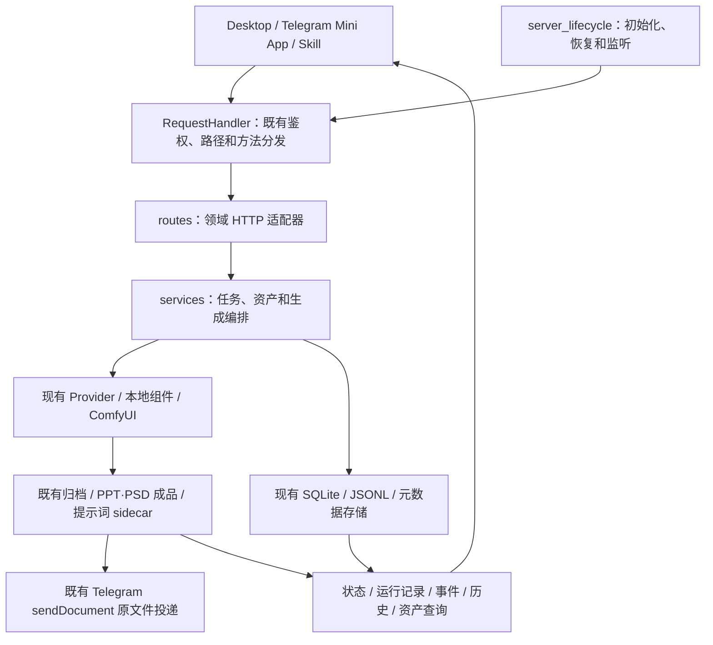

# 后端模块边界与运行约定

## 定位

保持个人/小团队、自包含、单机低维护的生产工具定位。本轮是代码组织重构：
不更换 HTTP 框架、数据库、部署模型，不引入微服务、消息队列或新的运行依赖。
前端仍消费已有 API；本轮不做 Canvas 拆分、Provider 协议重设计或计算进程池改造。

## 分层

- 根目录启动入口、watchdog、launchd、Electron 和 Docker 的原有运行方式不变。
- `backend/server.py` 是组合入口：保留原函数名/方法名、默认参数和显式依赖绑定。
- `backend/routes/` 处理参数、响应和原有 HTTP 异常边界。
- `backend/services/` 承担领域策略和业务编排；不反向导入 `backend.server`。
- Provider、数据库和文件存储模块仍拥有各自的实现，没有移入通用上下文对象。

## 模块索引

| 领域 | HTTP 模块 | 主要服务模块 |
| --- | --- | --- |
| 资产、候选集、历史 | `asset_*_routes`、`history_routes`、`asset_maintenance_routes` | `asset_files`、`asset_delete`、`asset_undo`、`asset_health`、`history_*`、`generation_timing`（统一总用时与本地分段耗时公开契约） |
| 图片、视频、归档资源 | `media_routes` | `media_lookup`、`image_import`、`archive_sidecars`、`archive_video` |
| 排版、字体、成品读取与操作 | `layout_routes`、`editable_routes` | `layout_publish`；沿用原草稿与成品存储 |
| 鉴权、设置、运行诊断 | `auth_routes`、`system_routes` | `auth_policy`、`system_settings` |
| 模型与账号管理 | `provider_account_routes` | `provider_accounts` |
| 提示词与远程素材 | `prompt_routes`、`remote_source_routes` | `prompt_presets`、`prompt_enrichment`、`prompt_video`（校验浏览器均匀抽取的 12–24 帧，按 8 帧分批理解并缓存文本摘要）；`prompt_skill_client` 的纯规则见下方；沿用原 Pinterest/同步实现 |
| Agent、工作流文件 | `agent_routes` | 沿用原 Agent runtime/store |
| 状态、重试、批次、并发 | `task_routes`、`task_control_routes` | `task_tracking`、`task_retry`、`task_batch`、`task_execution` |
| GPT 图片、编辑、PPT/PSD | `gpt_generation_routes` | `gpt_generation`、`editable_generation` |
| Google 生成与编辑 | `google_generation_routes` | `google_generation`、`telegram_notifications` |
| 路由容灾、参数和进度 | 经已有生成入口 | `provider_routing`、`provider_errors`、`generation_policy`、`generation_progress` |
| 放大、H3 视频、ComfyUI | `runtime_generation_routes` | `upscale_generation`、`video_generation`、`comfy_workflows`、`comfy_gateway`、`comfy_transport`、`comfy_generation` |
| Topaz 独立增强节点 | `topaz/routes.py` / 既有任务查询与取消 | `topaz/` 独立参数、服务适配、版本门禁与子进程；`services/image_enhancement` 仅共享归档/任务生命周期，Spandrel 不依赖 Topaz；见 `topaz/README.md` |
| Topaz Video 独立节点 | `routes/topaz_video_routes.py` | `topaz_video/` 独立模型目录、视频素材、串行任务、进度/取消/结果和本地子进程；不依赖 Gigapixel 图片域、ReShot 视频控制或音频域；见 `topaz_video/README.md` |
| 绘栾图像/视频 | `routes/cyimg_routes.py` | `provider_cyimg.py` 对接官方 API 与动态目录；`services/cyimg_generation.py` 校验、任务恢复、轮询、原件归档和 Telegram 投递 |
| Krea 2 本地图像 | `routes/krea2_routes.py` | `krea2/` 固定源码/模型准备、内容寻址 LoRA、Base 模型目录与离线量化转换、串行队列、共享 `.venv` 子进程与归档；见 `krea2/README.md` |
| Qwen 2.1 本地图像 | `routes/qwen21_routes.py` | `qwen21/` 独立固定源码/模型、文生图与有序多参考编辑、按版本/秩选择 Viggle 且步数可调、普通 LoRA、Base 转换/发布；共享 `.venv` 与本地加速器租约；见 `qwen21/README.md` |
| 本地图像公共设施 | `routes/local_image_routes.py` | `local_image/` 无架构依赖的进程监督、FP8 解码、原子权重保存、LoRA 文件库、任务队列、原件归档；不反向依赖 Krea/Qwen |
| 共享 LoRA 资料库 | `routes/lora_library_routes.py` | `lora_library/` 内容寻址资料、人工覆盖、示例图与独立 Civitai 补全；只通过注入端口访问模型目录，不依赖推理环境；见 `lora_library/README.md` |
| HTTP 公共响应、启动 | `http_responses` | `server_lifecycle` |

### 提示词客户端（`prompt_skill_client`）

`backend/prompt_skill_client.py` 拥有 Provider/模型选择、GPT OAuth 与 OpenAI 兼容调用、Codex → ChatGPT 账号池 fallback、generic-19 结果缓存、环境变量调参常量（及直接读取它们的函数）和全部公开入口（对话、润色、改写、素材块拆分、图片/视频分析）。入口调用的纯规则在 `services/` 下，不做网络/文件/设置/环境变量访问，依赖方向单向：

- `prompt_text_rules`：提示关键词与安全约束短语、M0–M14 公式模块推断与守卫、JSON/代码块清理、润色与风格提取结果整理。
- `prompt_adapter_rules`（依赖 text）：任务类型分类、风险评分、替换表、结构化兜底提示与安全改写输出清理；公开 `analyze_prompt_adapter`。
- `prompt_image_analysis_rules`（依赖 text）：图片分析 JSON 的类型标记、风格区域、主体/叠加元素、文字区域、占位槽位和中文主提示/负面提示整理。
- `prompt_block_rules`（依赖 text、image_analysis）：素材块主类型推断、模板与模块表（导入时由提示词库模板填充）、generic-19 锚点/约束/体型/质量/合并规则及图片分析拆块；公开 `generic_19_prompt_block_split_rule`。

原 `prompt_skill_client.<name>` 导入仍有效（入口用到的名称、公开名称和回归测试直接读取的私有名称均从原模块再导出）。测试替换点（`_choose_model`、`_call_prompt_provider`、`chat_chatgpt_pool`、调参常量等）都留在原模块，替换仍然生效。

## 保留的兼容边界

绘栾使用独立 `/api/cyimg/catalog|upload|submit` 鉴权路由；`server.py` 只装配服务/路由，任务状态继续复用 `/api/status/<id>` 和历史。Key 只在服务端设置中保存。目录按 `shizhuang` 图像及 `i2v`、`seedance`、`Minimax` 视频配置动态枚举渠道与模型，不把列表写死到前端；百分比费率不伪装成固定积分估价。远程任务 ID 持久化后，重启恢复只继续查询，绝不重放不确定的付费 POST。图像与视频原件保存到配置的逐日归档目录并写 `.txt` 提示词 sidecar；可选 Telegram 仍使用 `sendDocument`。这条线路不参与 Codex/账号池 fallback。

1. **有序路由不改写。** 精确路由仍使用原 `ProtectedRouter`；其余前缀、别名、鉴权顺序和静态回退保留在 `RequestHandler.do_*`。不添加尾斜杠归一化、二次解码、统一 405 或新 API。
2. **依赖逐次显式注入。** 原调用点和测试替换点仍有效；服务不通过 `globals()`、反向导入、动态属性代理或大型 Mixin 查找服务器状态。
3. **进程状态留在组合入口。** 登录状态、锁、缓存、批次控制和 semaphore 不复制到领域模块。保存设置后由 `_reload_auth_state()` 更新原进程鉴权变量，保留旧的更新顺序和失败边界。
4. **小型兼容适配器不是待拆业务单体。** Agent 删除的短 HTTP 适配器、放大进度回调、状态响应的旧 progress 默认值，以及 NDJSON 起始响应头保留在入口；复杂业务已独立。保留它们也避免破坏既有源码契约测试。
5. **默认参数和调用协议不变。** 两个依赖模块常量的 Google 默认值仍由旧入口绑定，再明确传给服务；任意 `**extra` 作为独立映射转发，避免与依赖关键字冲突。静态方法与生成器协议保留。
6. **不追求入口低于 500 行。** 入口仍包含导入、常量、显式装配和有序分发；不能用隐藏依赖或整体搬家换取表面行数下降。

## 生成与运行规则

- 保留 Codex → 账号池的现有 fallback 规则、错误详情、取消判定和事件记录；不新增提供商尝试或改变重试次数。
- PSD 可使用 Codex/第三方的原生图片能力，也保留账号池线路与原有托底；PPT 仍按现有规则走账号池。
- 保留任务 ID/Run ID、状态、已产生图片、归档目录、提示词 sidecar 和成品 manifest 的格式与写入顺序。
- Telegram 沿用 `sendDocument`，关闭发送和发送失败仍采用原有状态语义，不将保存成功误当作上游失败重做。
- 生成线程的 slot 获取、释放与异常边界由 `task_execution` 维护，process-owned semaphore 仍由原启动入口初始化。
- 高清放大继续使用已有独立组件；主 `.venv` 不含 Torch 不代表组件不可用。验收必须使用实际服务解释器及真实 worker。
- 启动的 DB 初始化、遗留任务处理、Agent 恢复、目录准备和监听顺序保持原样；新模块不会在 import 时额外启动服务。

### ComfyUI 任务通道

- `runtime_generation_routes` 仍只负责工作流准备、上传和 `POST /prompt`，并为每次提交生成独立 `client_id`；浏览器继续消费本地统一任务接口，不直接连接局域网 ComfyUI。
- `comfy_transport` 只维护 `ws(s)://<comfy>/ws?clientId=...` 事件通道，过滤其他任务事件、忽略二进制预览帧，并把执行/节点进度投影到已有任务状态。
- `comfy_gateway` 的 `/history/{prompt_id}` 仍是最终结果与错误事实来源，`/view` 仍负责结果字节下载；WebSocket 握手后会立即对账以关闭提交竞态，运行中仅保留 15 秒稀疏 history 看门狗，终态仍须对账再归档。
- WebSocket 组件缺失、握手失败或中途断开时，`comfy_generation` 自动回退到原 history 轮询，不更改前端 API、任务 ID、归档、sidecar 或 Telegram 原文件发送语义。

## 验收与回退

- 自动验收报告与逐批快照在本地忽略目录 `output/backend-modularization-validation/`，不属于发布依赖。
- 验收包含：当前工作区跟踪测试、原专项测试、模块绑定/行为契约、AST 迁移核对、隔离 HTTP 生成/成品链路、真实放大 worker 和空闲重启后的只读比对。
- Provider 网络结果在隔离链路中使用固定样本；PPT/PDF 预览、PSD 图层/ZIP 校验、归档、下载及 sendDocument 字节比较在本地实际执行。没有真实模型付费调用或 Telegram 投递。
- 所有写测试使用临时/报告目录中的任务、库和文件。真实资产不用于删除、撤销、清理、写设置或生成测试。
- 回退使用该批及之前的本地快照/差异，并按原服务空闲重启流程加载；不要重置整个工作区或覆盖用户已有改动。
- 新的回归测试保持在本地 `tests/`，默认不暂存、不提交；不得把配置秘密、运行数据库和测试产物加入版本控制。

本轮没有顺带统一历史异常状态或修复原有功能缺陷。已观察到的旧问题和最终手动测试边界以验收报告为准。

## Change2Pro 图片协议适配（2026-09-13）

- `provider_change2pro.py` 是无状态契约层：只识别 `api.change2pro.com` 的已知根/兼容入口；Google 使用原生 `generationConfig.imageConfig`，4K 生成与参考图编辑使用真正 `streamGenerateContent?alt=sse`。GPT 只校准已知 `/v1/images/*` 到文档 `/images/*`；其他域名、未知自定义路径不改。
- `gemini_image_response.py` 独立负责增量 JSON/SSE 解码与完整图片提取。遍历所有 candidate/part，支持跨块和多行事件；不会将前置文字当成整次出图失败；完整图片到达即结束，不等待连接 EOF。
- 装配方向：`api_client` / `provider_third_party_image` → 协议模块；`api_client` → Gemini 解码器。配置/会话仍属于客户端，任务状态仍属于现有服务；没有新全局状态、HTTP API、框架或进程。模块按普通 Python import 加载，不做启动时联网。
- Google Change2Pro 使用请求级 `x-goog-api-key`，模型保留用户所选 ID；只有明确模型不可用时允许既有别名适配。对连接中断/超时/5xx 不自动重放 POST，不自动回退 chat；其他供应商重试和 Codex→账号池 fallback 不变。该项是上述重构时“保持重试次数”的后续定向修正。
- `google_generation` 将实际尺寸、请求尺寸和协议元数据写入已有任务参数/事件；不符时保留原图与提示词 sidecar 并显示提示，不拉伸/缩放伪造 4K，不再次生成扣费。Telegram 仍发送原文件。
- 离线专项位于本地 ignored `tests/test_change2pro_adaptation_local.py`，报告位于 `output/change2pro-adaptation-20260913/`；无付费探测。

## Google OAuth 独立账号池（2026-09-14）

- `routes/google_pool_routes.py` 只适配受保护的 `/api/google-pool/*` 管理请求，`services/google_pool.py` 接收宿主注入的共享 sidecar URL / 本地认证；不读取或持有 GPT 账号。
- `provider_google_pool.py` 将既有图像任务转换为 Gemini native SSE，返回原图 bytes 和请求/实际模型元数据。`gemini_image_response.py` 增加可选 `on_document` 观察接口，原图片解码语义不变。
- `server.py` 仅装配 client/provider/router；`google_generation` 和 `task_batch` 负责选路和旧归档/投递流程，参数为 `google_provider_route`，默认 `third_party`，显式 `google_pool` 不落入 GPT fallback。
- `sidecars/account_service.py` 组合原 GPT app 与 `sidecars/google_pool`；后者具有独立 DB、OAuth、HTTP 适配和调度。完整配置、API、启动次序和取消语义见 `sidecars/google_pool/README.md`。冻结运行时已补 hidden imports，实际发布仍需重新打包。

## Independent music/audio domain

`audio/` owns the mlx-Yue request contract, serial jobs, local source assets, immutable
artifacts, a separate inference process using the shared main Python 3.14 environment,
a pinned optional dependency profile and native ABC helper. `routes/audio_routes.py` is the
only HTTP adapter; server assembly injects `APP_DATA_DIR` and an `AudioRuntime`. There are
no dependencies on image generation, image task state or account-pool services. See
`audio/README.md` for exact endpoints, installation, persistence and verification limits.

## Independent Krea 2 MLX domain

`krea2/` shares CanvasHub's main Python 3.14 virtual environment but keeps all MLX
imports inside a supervised child process. The upstream Krea source and the mflux
adapter are pinned source trees rather than installed distributions, so their stale
`mlx<0.32` metadata cannot downgrade the existing `mlx==0.32.2` / mlx-Yue profile.
`routes/krea2_routes.py` owns the authenticated transport; `Krea2Service` owns the
bounded serial queue, task DB projection, uploads, LoRA identities, custom Base
model catalog and archive; the conversion service/worker own strict local
checkpoint inspection, quantization and atomic publication;
`Krea2Runtime` owns worker lifecycle and the neutral local accelerator lease.
Both inference and conversion are offline and share that lease with YuE and the
other Mac-local domains. The pinned safety classifier is optional while the node
switch is off; when enabled, failure to load it fails the job instead of silently
bypassing filtering.
Results keep the daily archive, prompt sidecars and uncompressed Telegram delivery.
Exact installation, API and validation boundaries are in `krea2/README.md`.

## Independent video-control domain (ReShot)

`video_control/` owns local control-video contracts, source assets, durable jobs, cancellation,
model-fingerprinted caching and the pinned ReShot subprocess adapter. `routes/video_control_routes.py`
is its only HTTP adapter; server assembly injects `APP_DATA_DIR` and its runtime. No music/image
state is reused. Audio and ReShot explicitly share the neutral `runtime_resources.local_accelerator`
lease; their task databases remain separate. Byte-range file responses now live in
`routes/artifact_response.py`. Installation and validation limits: `video_control/README.md`.

## Independent Topaz Video domain

`topaz_video/` is a separate local-video domain: `catalog` defines model-specific controls,
`contracts` validates task requests, `features` validates composable filters/encoding and
inspects offline capabilities, `pipeline` builds ordered commands without owning processes
or task state, `runtime` selects explicitly staged local engines/weights,
and `service` owns source assets and durable job state. `routes/topaz_video_routes.py` is a thin
authenticated adapter for status, upload, submit, job, cancel and byte-range source/artifact reads.
`server.py` only injects `APP_DATA_DIR/components/topaz-video` and the task-data directory.
Neither the HTTP adapter nor the canvas node starts the Topaz GUI or downloads a model. Conventional
exports reference the current machine's activated license metadata in place; they are rejected
before publication unless the engine reports an owned-license checkout and no watermark fallback.
Catalog presence and staged assets are not proof of successful inference: model availability and
verification are reported separately. Precise, Mini and conventional enhancement have distinct
execution paths and acceptance status; see `topaz_video/README.md`.
The task contract supports explicit `preview` and `export` kinds plus a bounded
`start_seconds`/`max_seconds` range. Range conversion, video/audio alignment and
media metadata remain runtime/service responsibilities; the HTTP adapter does not
implement timeline policy.
The same runtime lifecycle executes stabilization, independent Nyx, Themis, enhancement,
interpolation/slow motion and Hyperion HDR. It checks every AI pass, maps output timing and
audio, cleans job-local intermediates and validates final HDR colour metadata. Production
never downloads; optional model import remains an explicit operator action. `status` separates
enhancement availability from filter capabilities and the editable MP4 encoding contract.

## Independent Qwen-Image 2.1 MLX domain

`qwen21/` owns Qwen contracts, immutable source/model preparation, architecture-specific
Base/LoRA validation, Viggle schedules, ordered reference editing, conversion, worker
and task orchestration. It shares the existing interpreter, never installs MFLUX into
it, and never imports Krea private code. Fixed source/weights, API and validation
boundaries are documented in `qwen21/README.md`.

`local_image/` contains neutral JSON-lines supervision, checkpoint inspection and
scaled-FP8 decoding, direct-folder LoRA identities, atomic safetensors publication,
uploads/queue/preparation/archive ports and checksum downloads. Krea compatibility
modules delegate supervision/FP8/scanning/atomic-save to these helpers without changing
its API, recipes or exception types. `routes/local_image_routes.py` binds the same
authenticated transport to explicit per-domain limits.

Server assembly owns `runtime_resources.IdleWorkerCoordinator`: every local engine
calls its explicit memory-release hook only after acquiring the shared accelerator
lease. Qwen/Krea keep warm workers, but the next local domain unloads their **idle**
workers before loading; active YuE/ReShot/Topaz work finishes rather than being killed.
Conversions inherit the lock FD into their one-off child, including cancellation.

Qwen's independent VAE registry (`qwen21/vae_store.py`) and worker-only component
view (`qwen21/vae_runtime.py`) extend that domain without changing shared Base pins
or other local-image domains. Selection and checkpoint identity are snapshotted
per task; the original MFLUX VAE path remains unchanged. Settings Model Tools uses
the existing Qwen controller/API, and no new dependency or process is introduced.
